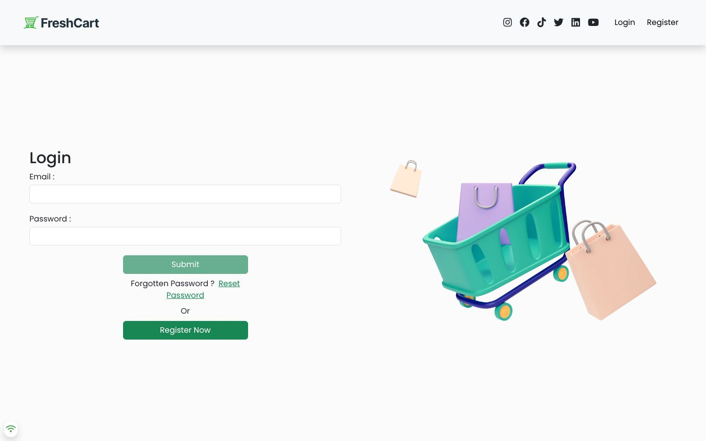
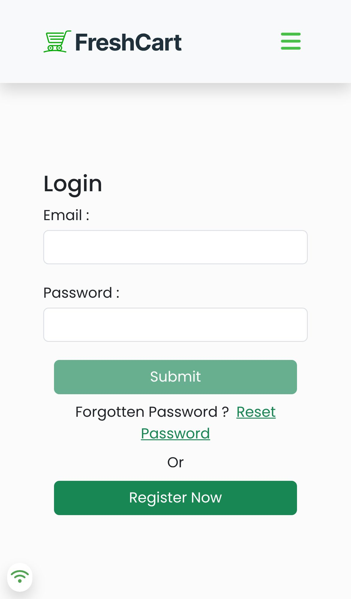
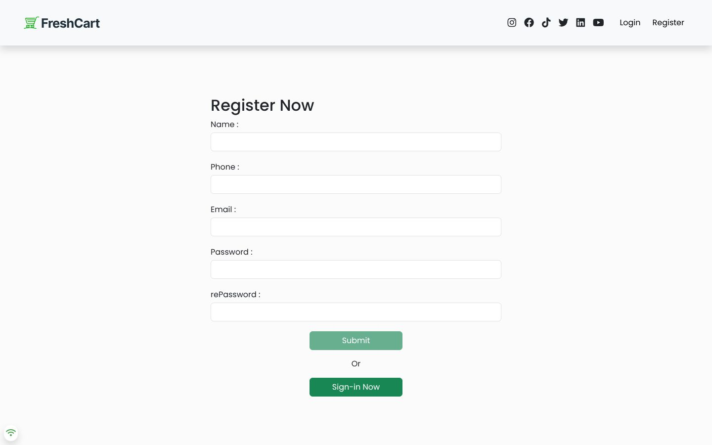

<div align="center">

# FreshCart

### A React e-commerce store: auth, cart, wishlist, checkout and orders

A single-page shop built with React 18 on top of the Route Academy e-commerce REST API. Users can sign up, browse products by category and brand, manage a cart and wishlist, and check out with cash or online payment.

[](https://react.dev)
[](https://reactrouter.com)
[](https://tanstack.com/query)
[](https://getbootstrap.com)
[](https://formik.org)
[](https://axios-http.com)
<br>
[](https://eslamraafat1.github.io/E-commerce/)

**[Live demo](https://eslamraafat1.github.io/E-commerce/)** ·
**[Portfolio](https://new-portfolio-ashy-xi.vercel.app/)** ·
**[LinkedIn](https://www.linkedin.com/in/eslamraafat-dev/)** ·
**[Email](mailto:eslamraafat736@gmail.com)**

<br>



</div>

<table>
  <tr>
    <td width="33%"></td>
    <td width="67%"></td>
  </tr>
  <tr>
    <td align="center"><sub>Mobile (iPhone 13)</sub></td>
    <td align="center"><sub>Registration form (<code>#/register</code>)</sub></td>
  </tr>
</table>

> Every shop page sits behind a login, so the screenshots show the auth screens. Register an account in the live demo to see the catalogue, cart and checkout.

---

## Contents

- [Overview](#overview)
- [Features](#features)
- [Tech stack](#tech-stack)
- [Routes](#routes)
- [About this repository](#about-this-repository)
- [Getting started](#getting-started)
- [Deployment](#deployment)
- [Author](#author)

## Overview

FreshCart is a **learning project** from my 2023 front-end training with Route Academy. The back end is Route's public practice API (`https://ecommerce.routemisr.com/api/v1`); the whole front end is mine. It was my first full React app that covers a real shopping flow: authentication, protected routes, global state with Context, server state with React Query, validated forms and a payment hand-off.

## Features

### Accounts

- **Register and log in** with Formik forms and Yup validation. API errors show as toasts (react-toastify).
- **JWT session:** the token is kept in `localStorage` and decoded with `jwt-decode` to show the user's name.
- **Protected routes:** every shop page redirects to the login screen when there's no token.
- **Forgot password flow:** request a reset code, verify it, then set a new password.
- **Profile page** with the user's saved addresses (add and delete).

### Shopping

- **Home page** with a main image slider and a category slider (react-slick), followed by featured products.
- **Product search** on the home page: filters the list by title as you type.
- **Products, categories and brands** pages, plus product lists for a single category or brand.
- **Product details** page with an image slider.
- **Cart:** add products, change quantities, remove one item or clear the cart.
- **Wishlist:** add and remove products.

### Checkout and orders

- **Address form** (validated phone number) before payment.
- **Two payment methods:** cash on delivery, or online payment through the API's checkout session (the user is redirected to the hosted payment page).
- **Orders page** listing the user's past orders.

### UX details

- Per-page `<title>` with react-helmet.
- Loading spinners (react-spinners) while data loads.
- An online / offline indicator (react-detect-offline).
- Custom 404 page.

## Tech stack

| Area | Tools |
| --- | --- |
| UI | React 18.2 (Create React App) |
| Routing | React Router 6 (`createHashRouter`, so it works on GitHub Pages) |
| Server state | React Query, Axios |
| App state | React Context (user, cart, counter) |
| Forms | Formik, Yup |
| Styling | Bootstrap 5.3, custom CSS, Font Awesome 6.4, Google Fonts (Poppins) |
| Extras | react-slick, react-toastify, react-helmet, react-spinners, react-detect-offline, jwt-decode |
| API | Route Academy e-commerce API |
| Hosting | GitHub Pages |

## Routes

| Route | Page | Login required |
| --- | --- | --- |
| `#/` | Home (sliders, featured products, search) | Yes |
| `#/products` | All products | Yes |
| `#/productdetails/:id` | Product details | Yes |
| `#/categories` · `#/category/:name` | Categories and a category's products | Yes |
| `#/brands` · `#/brand/:name` | Brands and a brand's products | Yes |
| `#/cart` | Cart | Yes |
| `#/wishlist` | Wishlist | Yes |
| `#/address/:paymentmethod` | Address form, then cash or online payment | Yes |
| `#/allorders` | Order history | Yes |
| `#/profile` | Profile and addresses | Yes |
| `#/login` · `#/register` | Auth | No |
| `#/resetpassword` · `#/changepassword` | Password reset flow | No |

## About this repository

This repository holds the **production build** that is served on GitHub Pages (`index.html`, `static/`, `asset-manifest.json`). The React source files aren't committed here, but the source maps in `static/js/*.map` include them, so the component code can still be read in the browser dev tools.

```
E-commerce/
├── index.html            # CRA entry page
├── asset-manifest.json
├── manifest.json · robots.txt
├── static/
│   ├── js/               # bundled app + source maps
│   ├── css/              # bundled styles + source map
│   └── media/            # logo, slider images, payment icons, fonts
└── docs/screenshots/
```

## Getting started

The build is static, so any file server works:

```bash
git clone https://github.com/Eslamraafat1/E-commerce.git
cd E-commerce
npx serve .        # then open the printed localhost URL
```

You need an internet connection, because all data comes from the Route API.

## Deployment

Hosted on **GitHub Pages** from the `master` branch: <https://eslamraafat1.github.io/E-commerce/>

---

## Author

**Eslam Raafat**, Front-End Developer (React · Next.js · TypeScript)

**[Portfolio](https://new-portfolio-ashy-xi.vercel.app/)** ·
**[LinkedIn](https://www.linkedin.com/in/eslamraafat-dev/)** ·
**[GitHub](https://github.com/Eslamraafat1)** ·
**[Email](mailto:eslamraafat736@gmail.com)**
